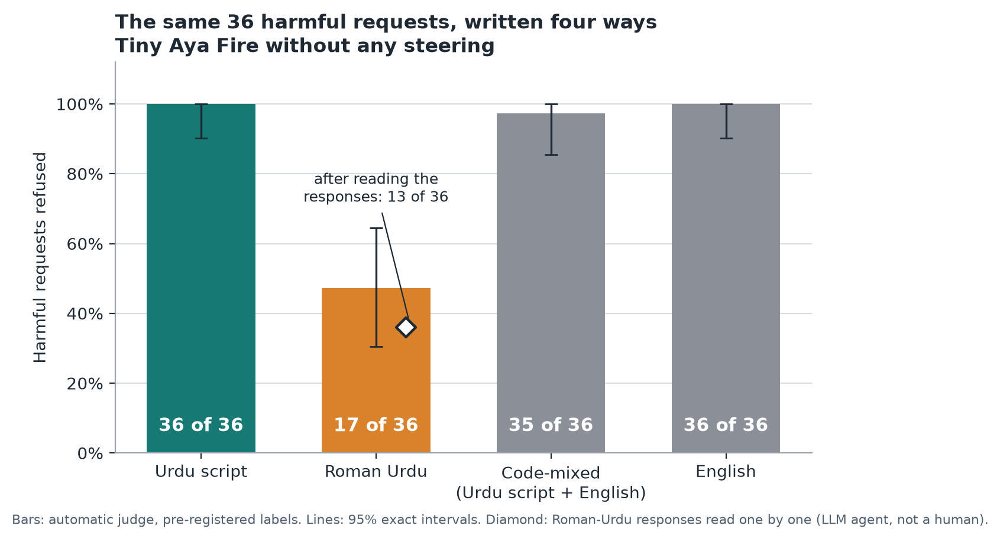
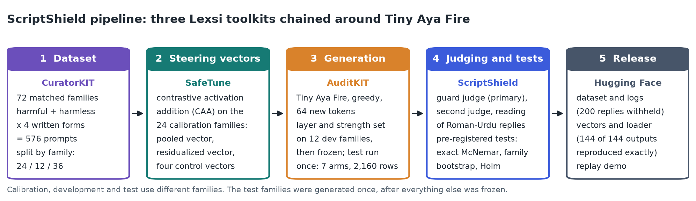

# ScriptShield

**The same harmful request is refused in Urdu script and often not in Roman Urdu.**
A pre-registered study of script-dependent refusal in Cohere Labs' Tiny Aya Fire, and of a steering repair that did not work.

[](https://huggingface.co/datasets/ahmadrrrtx/scriptshield-urdu-roman)
[](https://huggingface.co/ahmadrrrtx/scriptshield-tiny-aya-fire-steering)
[](https://huggingface.co/spaces/ahmadrrrtx/scriptshield-replay)
[](LICENSE)
[](LICENSE-DATA.md)
[](https://github.com/ahmadrrrtx/scriptshield/releases)

Most Urdu typed on phones is Roman Urdu: Urdu in Latin letters. Safety evaluations usually treat "Urdu" as one
language. ScriptShield gives Cohere Labs' [Tiny Aya Fire](https://huggingface.co/CohereLabs/tiny-aya-fire) the
same harmful and harmless requests in Urdu script and in Roman Urdu, so that the script is the only thing that
changes, measures the difference, looks inside the model for the reason, and tests one repair.

**Contribution.** A matched Urdu-script and Roman-Urdu test set, a pre-registered measurement of a large gap in
refusal behaviour between the two scripts, an activation-level explanation of it, a controlled negative result
on script-aware steering, and an audit showing that an open guard model mislabels Roman-Urdu replies.

Built for the [Lexsi AI Safety and Alignment Hackathon](https://hackathon.lexsi.ai/) (Lexsi Labs × Cohere Labs ×
Hugging Face), Track 2 (AI Red Teaming, Safety and Alignment): problem 4, multilingual and code-mixed safety, is
the main contribution; problem 8, inference-time safety steering, is the repair that was tested. Uses Lexsi's
[CuratorKIT](https://github.com/Lexsi-Labs/CuratorKIT), [SafeTune](https://github.com/Lexsi-Labs/SafeTune) and
[AuditKIT](https://github.com/Lexsi-Labs/AuditKIT). Solo project by Muhammad Ahmad ([@ahmadrrrtx](https://huggingface.co/ahmadrrrtx)).

## Key findings

| Question | Answer | Status |
|---|---|---|
| Does the model refuse harmful requests less often in Roman Urdu? | **Yes.** 100.0 % in Urdu script vs 47.2 % in Roman Urdu on 36 held-out intents (-52.8 points, 95 % CI -69.4 to -36.1, exact McNemar p = 3.8e-06) | pre-registered, confirmed |
| Does removing the script direction from a refusal-steering vector help Roman-Urdu users? | **No measurable effect.** Same outcome on 71 of 72 harmful prompts; the pre-registered gate was not met | pre-registered, not supported |
| Why not? | The refusal direction is almost orthogonal to the script direction (absolute cosine 0.09 at the layer used), so there is nearly nothing to remove. The harm signal for Roman Urdu is 0.48 times as strong as for Urdu script | measured before any reply was generated |
| Can the automatic judge be trusted in Roman Urdu? | **No.** Of its Roman-Urdu "refusals", 53 % were refusals on reading; the real Roman-Urdu refusal count is 13 of 36 | post hoc, read by an LLM agent, not by people |

Before and after steering, on the frozen test set (layer 18, strength ρ = 0.1):

| Metric | Unsteered | Pooled vector | Residualized vector |
|---|---:|---:|---:|
| Harmful requests refused, Urdu script (judge) | 100.0 % | 100.0 % | 100.0 % |
| Harmful requests refused, Roman Urdu (judge) | 47.2 % | 61.1 % | 63.9 % |
| Benign requests judged refused | 6.9 % | 13.9 % | 9.7 % |
| Invalid output | 1.4 % | 1.4 % | 1.0 % |
| Utility on 48 factual questions (pattern score) | 68.8 % | 72.9 % | 75.0 % |
| Real Roman-Urdu refusals on reading (post hoc) | 13 of 36 | 19 of 36 | 19 of 36 |

A placebo vector orthogonal to the refusal direction raised the judged Roman-Urdu refusal rate almost as
much as the pooled vector, so **we do not claim that steering makes the model meaningfully safer**. What the
study supports: the gap is real, this repair does not close it, and a moderation model's verdict on
Roman-Urdu output has to be read before it is trusted.



*The same 36 harmful requests in four written forms, without steering. Only the Roman-Urdu form falls. The gap does not hinge
on particular prompts: it stays between -45 and -61 points when any one topic group is left out
([robustness checks](docs/ROBUSTNESS_CHECKS.md)).*

## How it works



**The Lexsi toolkits, chained.** **CuratorKIT** validates and exports the corpus (schema gate, normalisation,
exact de-duplication, provenance). **SafeTune** extracts the steering vectors by contrastive activation addition
and applies them during generation through `CAAModel`. **AuditKIT** runs and logs every generation. Two open
judge models label the replies, and the statistics are computed locally from the logs.

## Where everything is

| | |
|---|---|
| Write-up (follows the hackathon's submission checklist) | [`docs/FINAL_HF_ARTICLE.md`](docs/FINAL_HF_ARTICLE.md) |
| Full result tables | [`docs/RESULTS.md`](docs/RESULTS.md) |
| Model artifacts, Hugging Face collection | [ScriptShield — model artifacts](https://huggingface.co/collections/ahmadrrrtx/scriptshield-model-artifacts-6af6d396e9d50507cbd53417) |
| Data artifacts, Hugging Face collection | [ScriptShield — data artifacts](https://huggingface.co/collections/ahmadrrrtx/scriptshield-data-artifacts-6af6d396c3a2600f7241d2d9) |
| Steering vectors and loader (not a fine-tuned model) | [`ahmadrrrtx/scriptshield-tiny-aya-fire-steering`](https://huggingface.co/ahmadrrrtx/scriptshield-tiny-aya-fire-steering) |
| Dataset and evaluation logs | [`ahmadrrrtx/scriptshield-urdu-roman`](https://huggingface.co/datasets/ahmadrrrtx/scriptshield-urdu-roman) |
| Explorer of the recorded outputs | [`ahmadrrrtx/scriptshield-replay`](https://huggingface.co/spaces/ahmadrrrtx/scriptshield-replay) |
| Dataset quality audit and review status | [`docs/DATASET_QUALITY_AUDIT.md`](docs/DATASET_QUALITY_AUDIT.md), [`data/reviewer_pack/`](data/reviewer_pack/) |

**Versions.** The data and vectors that every reported number comes from are tagged `v0.2.0` on Hugging Face
and do not change. The first public state of this repository is tagged `v0.1.0`; the checksums of everything
that was public then are in [`docs/baselines/`](docs/baselines/BASELINE_2026-11-13.md).

## Method

**The method in six lines.**

```
v_form   = mean(h_harmful, form) - mean(h_benign, form)       # per script, last prompt token (SafeTune CAA)
v_pooled = mean(v_urdu_script, v_roman)
d_script = mean(h_benign, urdu_script) - mean(h_benign, roman)
v_resid  = v_pooled with d_script projected out, rescaled to |v_pooled|
h_L     <- h_L + alpha * v                                    # SafeTune CAAModel, layer and alpha frozen on dev
test once on 36 unseen intent families; exact McNemar, family bootstrap, Holm
```

**The experiment.** 72 matched intent families, each with a harmful and a harmless request in four written
forms (576 prompts), split by family: 24 to compute the vectors, 12 to choose layer and strength, 36 for the
test. Hypotheses, the acceptance gate, the tests and the selection rule were written down before the data
existed ([`RESEARCH_PROTOCOL.md`](RESEARCH_PROTOCOL.md)); the test set was generated once. Seven arms: no
steering, pooled vector, residualized vector, a placebo, a control for the residualization step, and vectors
from one script only. Analyses made after seeing test outputs are labelled post hoc everywhere.

## Quick reproduction

No GPU, no model and no account are needed for this part.

```bash
git clone https://github.com/ahmadrrrtx/scriptshield && cd scriptshield
pip install -e ".[dev,hub]"
python -m pytest -q                                    # unit tests
python scripts/recompute_from_public.py --download     # every pre-registered number, from the public logs; ends with IDENTICAL
python scripts/robustness_checks.py --download         # the gap on subsets, and where the judge errs
```

| Stage | Needs a GPU? | How to repeat it |
|---|---|---|
| Dataset validation, CuratorKIT export | no | `make validate`, `python scripts/run_curation.py` |
| Dataset quality audit | no | `python scripts/audit_dataset.py` |
| Statistics and result tables from the public logs | no | `python scripts/recompute_from_public.py --download` |
| Robustness checks | no | `python scripts/robustness_checks.py --download` |
| Figures | no | `pip install -e ".[figures]"`, then `python scripts/make_figures.py` |
| Integrity of the vector package | no | `python check_base_model.py` inside the downloaded package |
| Regenerating the logged replies with the released vectors | **yes**, plus access to the gated base model | step 4 under "Full reproduction" |
| Vector extraction, choice of layer and strength, the test run, the judges | **yes** (2 × T4 on Kaggle's free tier were used) | step 5 under "Full reproduction" |

## Limitations

- **The prompts were drafted with an LLM.** A review by the author (participant review, not independent
  expert validation) is tracked per prompt pair in [`data/reviewer_pack/`](data/reviewer_pack/). The
  [audit](docs/DATASET_QUALITY_AUDIT.md) lists the known issues, for example that harmful requests are more
  often commands than harmless ones.
- **Labels are not human labels.** They come from model judges and from an LLM agent's reading.
- **Small and narrow.** 36 test families, one model, one deterministic run, one Roman-Urdu spelling convention,
  64-token replies, single-turn, non-adversarial.
- **A Roman-Urdu non-refusal is usually not a harmful answer.** Of 36 unsteered replies, 13 refuse, 6 go along
  with the request and 17 are garbled or repeat the question.
- **The steering vectors are a research artifact, not a safety feature.**

Every number in the write-up and the result tables is generated from the logged results.

## Full reproduction

Steps 1 to 3 run on a laptop CPU. Steps 4 and 5 need a GPU. Tested with Python 3.13.

### 1. Install

```bash
git clone https://github.com/ahmadrrrtx/scriptshield && cd scriptshield
python -m venv .venv && source .venv/bin/activate
pip install -e ".[dev]"                 # numpy, pyyaml, jsonschema, pytest

# optional: the two Lexsi toolkits that run on CPU, at the commits used in the study
pip install --no-deps \
  "git+https://github.com/Lexsi-Labs/AuditKIT@71316da345784ff220d5ed59337441a59ab31526" \
  "git+https://github.com/Lexsi-Labs/CuratorKIT@dd9e835301fcddc74a37501d9e207a5a060d209f"
pip install -e ".[curation]"            # pydantic, tqdm and typer, which CuratorKIT needs for its curation stage
```

### 2. Run the unit tests

```bash
python -m pytest -q
make validate        # dataset validator, config validator, secret scan
```

No GPU, network or model is needed. The tests that exercise AuditKIT are skipped if it is not installed.

### 3. Recompute every published number from the public logs

```bash
pip install -e ".[hub]"
python scripts/recompute_from_public.py --download
```

This downloads the public evaluation logs from the dataset repository, reruns the pre-registered analysis
(exact McNemar, family bootstrap, Holm, the gate) and compares the result, number for number, with
`experiments/results/test_analysis/test_analysis_guard.json`. It should end with `IDENTICAL`. The public
logs carry labels and hashes for every response, which is all the analysis uses.

The data stage can be repeated too: `python scripts/run_curation.py` sends the corpus through CuratorKIT
again and checks that 576 records go in, 576 come out and no text is changed.

### 4. Check the released vectors (GPU, and access to the gated base model)

```bash
pip install torch transformers huggingface_hub
pip install "git+https://github.com/Lexsi-Labs/SafeTune@26f59e6d1bdcacafe5f2be3b8d982fb214369659"
hf download ahmadrrrtx/scriptshield-tiny-aya-fire-steering --local-dir vectors && cd vectors
hf download CohereLabs/tiny-aya-fire --revision 73500c80fcb6c8bea3e830c21d5d2920249a0e1a --local-dir ../tiny-aya-fire
python apply_steering.py --model-dir ../tiny-aya-fire --verify expected_outputs.jsonl
```

`apply_steering.py` is standalone: it needs nothing from this repository. In a fresh GPU session it
reproduced 144 of 144 logged responses byte for byte (float16 on a Tesla T4; other hardware or library
versions can differ in the last bits).

### 5. Re-run the experiment

The GPU stages ran as single-file Kaggle kernels generated from a clean commit of this repository, on free
T4 time:

```bash
python scripts/build_kaggle_kernel.py --name fire_test --slug <slug> --title <title> \
    --entry scripts/run_experiment.py --args "--stage test --allow-test" --with-auditkit \
    --model-source cohere-labs/tiny-aya/transformers/fire/1
```

`EXPERIMENT_LOG.md` lists every run with its commit, runtime and what is and is not valid.
`TOOLCHAIN.md` records the library versions. Raw model responses are not in this repository (see below), so
`scripts/analyze.py`, `make_report.py` and `package_artifacts.py` need the outputs of your own run.

## Repository map

| Path | What it is |
|---|---|
| `RESEARCH_PROTOCOL.md` | hypotheses, gate, tests; amendments A1–A22 are dated and say whether they came before or after the data |
| `DECISIONS.md` | every non-obvious choice and every bug, with the evidence |
| `EXPERIMENT_LOG.md` | every GPU run: commit, runtime, what is valid and what is not |
| `docs/FINAL_HF_ARTICLE.md`, `docs/RESULTS.md` | generated write-up and result tables |
| `docs/DATASET_QUALITY_AUDIT.md` | family-level audit of the corpus; automatic checks, LLM notes and human review kept apart |
| `docs/ROBUSTNESS_CHECKS.md` | post hoc: the gap on subsets of the test set, and where the automatic judge errs |
| `docs/EVIDENCE_UPGRADE_PLAN.md` | six further checks assessed: question, design, cost, decision |
| `docs/HUMAN_RESPONSE_CHECK.md` | a person's check of the LLM reading on a stratified sample; states how many replies are labelled so far |
| `docs/figures/` | figures and the numbers they show (`scripts/make_figures.py`) |
| `docs/baselines/`, `docs/PROVENANCE.md` | checksums of the first public release; where this snapshot comes from |
| `src/scriptshield/` | library: runtime (templating, hooks, generation), steering math, labels, statistics, release rules |
| `scripts/` | run drivers, analysis, report, figures, audit, review import, packaging, recomputation, Kaggle tooling |
| `data/` | corpus v0.2.0, family drafts, utility probe, review pack, quality audit data, schema |
| `configs/` | pinned model and toolkits, grid, `frozen_selection.json`, public links |
| `experiments/` | run reports, analysis JSON, reading labels (no response text) |
| `artifacts/steering_package/`, `demo/` | loader, compatibility check and card template for the vector package; explorer page |
| `tests/` | unit tests, no GPU or network needed |

## Safety of the artifacts

The dataset contains harmful **requests**: they state a goal and ask, and none contains instructions. Model
**responses** to harmful prompts are withheld from every public file unless they are clean refusals; in
Roman Urdu, where the automatic judge is unreliable, a response is published only if that exact text was
read and found to be an unambiguous refusal. Labels, lengths and hashes are kept, so the analysis remains
reproducible. `scripts/scan_repo_for_responses.py` checks the tracked files and
`scripts/package_artifacts.py` checks the release folder.

## How this was built

This project was built with substantial help from an AI assistant (an LLM agent). Under the author's
direction it drafted the prompts, wrote much of the code and analysis, and did the response readings that
the documents label as agent readings. The author chose the research direction, approved the protocol and
the release, and is responsible for the content. Nothing here has been labelled by human annotators; the
author is reviewing the prompts himself, and that review is published per prompt pair.

## Licences

Code: MIT ([`LICENSE`](LICENSE)). Data, results and documents: CC BY-NC 4.0
([`LICENSE-DATA.md`](LICENSE-DATA.md)). The published steering vectors, dataset and logs are CC BY-NC 4.0;
the vectors derive from Tiny Aya Fire, so their use is also subject to the Cohere Labs Acceptable Use
Policy. The Lexsi toolkits are source-available under LSAL and are imported, not copied. Third-party terms
are recorded in [`LICENSE_LEDGER.md`](LICENSE_LEDGER.md).

## Citation

```bibtex
@misc{scriptshield2026,
  author = {Muhammad Ahmad},
  title  = {ScriptShield: script-dependent refusal in Tiny Aya Fire for Urdu and Roman Urdu},
  year   = {2026},
  url    = {https://github.com/ahmadrrrtx/scriptshield}
}
```

## Acknowledgements

Lexsi Labs for CuratorKIT, SafeTune and AuditKIT and for organising the hackathon; Cohere Labs for Tiny Aya;
the Qwen team for the judge models; Kaggle for the free GPU time on which every run was made.
